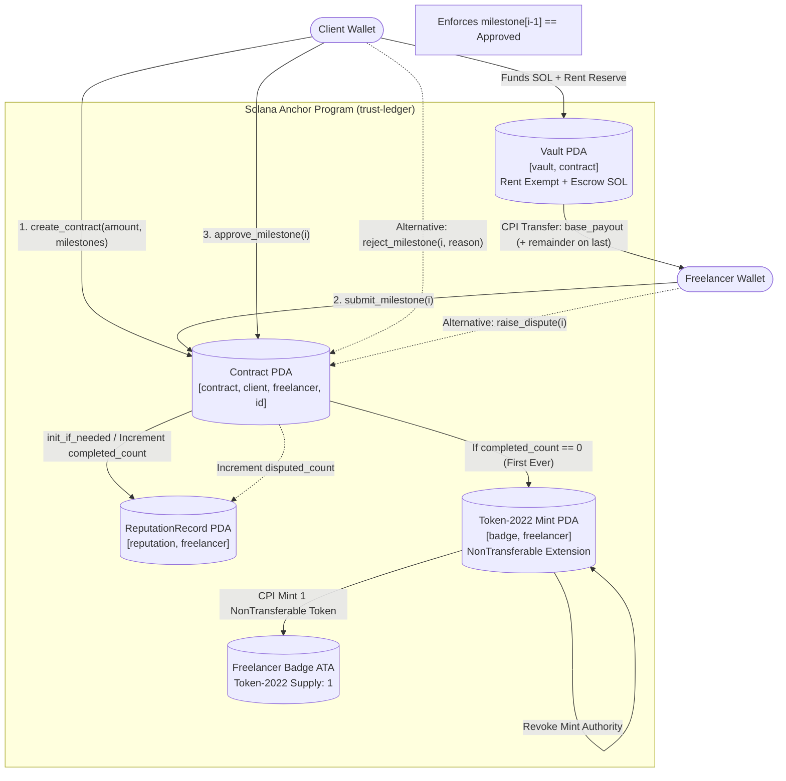

# Project Breakdown: Trust Ledger

---

## 1. Project Snapshot

* **What the product does:** Trust Ledger is an on-chain milestone escrow and portable reputation protocol built on the Solana blockchain. It enables trustless peer-to-peer contracting where clients deposit escrowed funds into a Program Derived Address (PDA) vault, releasing funds sequentially upon client milestone approval without custodial platform lock-in. Completing milestones permanently updates a public `ReputationRecord` on-chain, automatically mints a non-transferable (soulbound) Token-2022 verification badge upon first completion, and provides an AI-powered reputation inquiry agent backed by OpenAI function calling and Solana RPC state verification.
* **My likely role/contribution:** Sole Architect & Full-Stack Web3 Engineer (authored **24 of 24 commits**—100% solo authorship under Russell Oje / `ruxy1212`; engineered the Solana Anchor Rust smart contract, raw CPI Token-2022 extension initialization, deterministic PDA derivation schemas, 14-test on-chain integration suite, Next.js 16 / React 19 Web3 frontend, RPC `memcmp` indexing filters, and an AI reputation lookup agent with prompt injection barriers and 0-token fast-path resolution). Built originally as a capstone for Major League Hacking's (MLH) *100 Days of Solana* and advanced for the Solana Foundation Grant track.
* **Tech stack:**
  * **On-Chain Smart Contracts:** Rust (Edition 2021, rust-version 1.89), Anchor Framework (`anchor-lang: 1.1.2` with `init-if-needed`), SPL Token-2022 (`spl-token-2022: 11.0.0` with `NonTransferable` extension), SPL Associated Token Account (`spl-associated-token-account: 8.0.0`), Deployed Devnet Program ID `E68AQePth8MVtn2aHax23c6BWye8Mnw2fkDzCyTfqNEk`.
  * **Frontend Client:** Next.js 16 (`next: 16.2.12` App Router), React 19 (`react: 19.2.4`), TypeScript 5 (`typescript: ^5`), Tailwind CSS v4 (`tailwindcss: ^4`), Motion 12 (`motion: ^12.43.0`), Geist fonts, `@bprogress/next: ^3.2.12`.
  * **Solana Web3 SDKs:** `@solana/web3.js: ^1.98.4`, `@coral-xyz/anchor: ^0.32.1`, `@anchor-lang/core: ^1.1.2`, `@solana/spl-token: ^0.4.15`, `@solana/wallet-adapter-react: ^0.15.39`, `@solana/wallet-adapter-react-ui: ^0.9.39`, `bn.js: ^5.2.5`.
  * **AI & Agent Services:** OpenAI SDK (`openai: ^7.1.0`), Function Calling / Tool Calling (`check_reputation`), in-memory sliding-window IP rate limiting (`checkRateLimit`), Base58 regex fast-path bypass.
  * **Testing & Tooling:** Mocha 11, Chai 6, `ts-mocha: ^11.1.0`, `ts-node: ^10.9.2`, Anchor CLI.
* **Project scale:**
  * **24 total Git commits** (24 authored by Russell Oje—100% ownership).
  * **1 deployed Anchor Solana smart contract** with 6 entrypoint instructions and 5 PDA account schemes.
  * **14 on-chain TypeScript Anchor integration tests** (`tests/trust-ledger.ts`, 1,224 lines) validating state machines, remainder distribution, and SPL Token-2022 transfer blocks.
  * **14 frontend test specifications** (`app/src/tests/trust-ledger.test.ts`).
  * **37 frontend/agent TypeScript/React files** across 5 App Router pages, 2 API routes, and 7 UI components.

---

## 2. Engineering Metrics

### Smart Contract & On-Chain Architecture
* **Program Instructions:** 6 core state-transition instructions:
  1. `create_profile`: Registers optional freelancer metadata (`FreelancerProfile`).
  2. `create_contract`: Initializes contract PDA, validates milestone counts (1–10), and transfers escrow amount + permanent rent-exempt reserve into the vault PDA.
  3. `submit_milestone`: Transitions milestone from `NotSubmitted` or `Rejected` to `Submitted`, enforcing strict sequential prerequisites ($i > 0 \implies \text{milestone}[i-1] == \text{Approved}$).
  4. `approve_milestone`: Client signs release of base payout + remainder via PDA CPI signer; initializes/increments `ReputationRecord`; mints soulbound Token-2022 badge on first completion.
  5. `reject_milestone`: Client records rejection with UTF-8 reason string (bounded at 200 chars).
  6. `raise_dispute`: Freelancer freezes rejected milestone into `Disputed` and increments `disputed_count`.
* **PDA State Derivations:** 5 distinct seed schemas:
  * `[b"profile", freelancer_pubkey]`
  * `[b"contract", client_pubkey, freelancer_pubkey, contract_id.to_le_bytes()]`
  * `[b"vault", contract_pda]`
  * `[b"reputation", freelancer_pubkey]`
  * `[b"badge", freelancer_pubkey]` (PDA mint authority)
* **Custom Error Codes:** 11 typed error variants in [`CapstoneError`](file:///C:/laragon/www/react/ideas/solana-grant/trust-ledger/program/src/errors.rs) preventing unauthorized signers, out-of-order submissions, duplicate approvals, disputed tampering, and payload overflows.
* **Solana Token-2022 Soulbound Badges:** Direct low-level CPI invocation executing `ExtensionType::NonTransferable` TLV memory allocation, pre-mint extension initialization, PDA self-minting, and permanent revocation of `AuthorityType::MintTokens` to enforce a strictly non-transferable single-supply badge.

### Frontend & Agent Integration
* **Next.js 16 & React 19 Web3 Integration:** Dual-program instantiation ([`anchor-client.ts`](file:///C:/laragon/www/react/ideas/solana-grant/trust-ledger/app/src/lib/anchor-client.ts)) providing an authenticated `AnchorProvider` for wallet signatures and a public `Connection` `readOnlyProgram` for zero-friction viewer queries.
* **RPC Indexing Optimizations:** High-efficiency client/freelancer contract discovery using raw `getProgramAccounts` memory comparison (`memcmp`) filters at binary byte offsets:
  * `CLIENT_OFFSET = 8` (immediately following the 8-byte Anchor account discriminator).
  * `FREELANCER_OFFSET = 40` (8-byte discriminator + 32-byte client pubkey).
* **AI Agent Pipeline:** OpenAI function-calling gateway ([`route.ts`](file:///C:/laragon/www/react/ideas/solana-grant/trust-ledger/app/src/app/api/agent/route.ts)) equipped with:
  * **0-Token Fast-Path Engine:** Regex check (`/^[1-9A-HJ-NP-Za-km-z]{32,44}$/`) intercepts raw Solana base58 wallet inputs, executing an instantaneous on-chain RPC lookup via [`check-reputation.ts`](file:///C:/laragon/www/react/ideas/solana-grant/trust-ledger/app/src/agent/tools/check-reputation.ts) without consuming LLM API credits.
  * **Prompt Injection Defense:** Strict system boundaries treating on-chain freelancer `displayName` strings as untrusted data rather than prompt instructions, accompanied by non-printable control character sanitization (`/[\x00-\x1F\x7F]/g`).
  * **Sliding Rate Limiter:** Per-IP windowing (10 requests/minute for AI gateway, 60 requests/minute for direct reputation API) returning standard HTTP 429 and `Retry-After` headers.

---

## 3. What I Built

### 1. Trustless On-Chain Milestone Escrow Engine
* **The Problem:** Traditional freelance platforms act as centralized custodians, holding payments under multi-week holds, taking 10–20% platform fees, and risking arbitrary payout freezing or client chargebacks.
* **How I Solved It:** Designed an Anchor smart contract where clients lock escrow funds inside a deterministic, program-owned PDA vault (`[b"vault", contract.key()]`). Payouts are mathematically split into `base_payout` ($amount / N$) and `remainder` ($amount \% N$). Funds can never be drained by the client unilaterally or intercepted by third parties; they release via CPI `transfer` instructions signed by the vault PDA seeds solely when the client executes [`approve_milestone`](file:///C:/laragon/www/react/ideas/solana-grant/trust-ledger/program/src/instructions/approve_milestone.rs).
* **Key Files:**
  * [`program/src/instructions/create_contract.rs`](file:///C:/laragon/www/react/ideas/solana-grant/trust-ledger/program/src/instructions/create_contract.rs): Initializes contract state and funds vault.
  * [`program/src/instructions/approve_milestone.rs`](file:///C:/laragon/www/react/ideas/solana-grant/trust-ledger/program/src/instructions/approve_milestone.rs): Releases milestone lamports and settles integer division remainders.

### 2. Low-Level Token-2022 Soulbound Verification Badge
* **The Problem:** Freelancer credentials on existing platforms are non-portable web2 database entries. Moving off-platform erases reviews. Furthermore, classic SPL tokens can be transferred or sold, defeating the purpose of an authentic reputation credential.
* **How I Solved It:** Implemented a raw Token-2022 Non-Transferable (Soulbound) mint in [`badge.rs`](file:///C:/laragon/www/react/ideas/solana-grant/trust-ledger/program/src/badge.rs). Because Anchor’s declarative `init` macro does not support initializing Token-2022 extensions before mint initialization, I authored raw Solana CPI sequences:
  1. Calculated account size using `ExtensionType::try_calculate_account_len::<Token2022Mint>(&[ExtensionType::NonTransferable])`.
  2. Invoked `system_instruction::create_account` targeting `TOKEN_2022_PROGRAM_ID`.
  3. Invoked `initialize_non_transferable_mint` *before* the base mint initialization.
  4. Executed `initialize_mint2` with 0 decimals, delegating authority to the PDA mint itself.
  5. Created the freelancer's Associated Token Account (ATA) and minted exactly 1 token.
  6. Invoked `set_authority` with `AuthorityType::MintTokens` set to `None`, permanently burning the mint authority to enforce a 1-of-1 supply cap.
* **Key Files:**
  * [`program/src/badge.rs`](file:///C:/laragon/www/react/ideas/solana-grant/trust-ledger/program/src/badge.rs): Low-level CPI allocation and extension initialization.
  * [`tests/trust-ledger.ts#L1180-L1223`](file:///C:/laragon/www/react/ideas/solana-grant/trust-ledger/tests/trust-ledger.ts#L1180-L1223): Automated test asserting SPL Token program rejection when transferring the badge.

### 3. Sequential State Machine with Dispute Freezing
* **The Problem:** In milestone contracting, freelancers must not jump ahead to final milestones while earlier deliverables remain unsubmitted or unapproved, and rejected work must have formal dispute recourse.
* **How I Solved It:** Formulated a strict sequential milestone state machine:
  * Milestone submissions require previous milestones to be `Approved`:
    ```rust
    if index > 0 {
        require!(
            contract.milestones[(index - 1) as usize] == MilestoneStatus::Approved,
            CapstoneError::PreviousMilestoneNotApproved
        );
    }
    ```
  * Rejections require an on-chain explanation string (up to 200 characters) stored in `rejection_reasons`.
  * If a client unfairly rejects, the freelancer can call [`raise_dispute.rs`](file:///C:/laragon/www/react/ideas/solana-grant/trust-ledger/program/src/instructions/raise_dispute.rs), which freezes the milestone in `Disputed` state (blocking both re-submission and rejection) and automatically increments the freelancer's public `disputed_count`.
* **Key Files:**
  * [`program/src/instructions/submit_milestone.rs`](file:///C:/laragon/www/react/ideas/solana-grant/trust-ledger/program/src/instructions/submit_milestone.rs): Enforces chronological progression.
  * [`program/src/instructions/reject_milestone.rs`](file:///C:/laragon/www/react/ideas/solana-grant/trust-ledger/program/src/instructions/reject_milestone.rs): Stores rejection reasoning.
  * [`program/src/instructions/raise_dispute.rs`](file:///C:/laragon/www/react/ideas/solana-grant/trust-ledger/program/src/instructions/raise_dispute.rs): Freezes milestone and increments dispute counter.

### 4. Zero-Cost Fast-Path AI Reputation Agent
* **The Problem:** Building AI agents to query blockchain data often incurs heavy LLM latency and expensive API token costs for trivial lookups, while exposing the backend to prompt injection via on-chain text fields.
* **How I Solved It:** Built an intelligent reputation query route ([`api/agent/route.ts`](file:///C:/laragon/www/react/ideas/solana-grant/trust-ledger/app/src/app/api/agent/route.ts)) and floating UI widget ([`ReputationAgentWidget.tsx`](file:///C:/laragon/www/react/ideas/solana-grant/trust-ledger/app/src/components/ReputationAgentWidget.tsx)):
  * Implemented an upstream regex gate checking if the input is a valid Solana base58 address. If true, it bypasses the LLM entirely, executes the tool function directly, and returns the result with `viaModel: false` at 0 API token cost.
  * For natural language queries ("how reliable is wallet X?"), the route invokes `gpt-4o-mini` with a tool definition (`check_reputation`).
  * Implemented prompt injection shielding by stripping non-printable characters (`/[\x00-\x1F\x7F]/g`) from on-chain `displayName` strings before passing them into the LLM context, instructing the system prompt that tool outputs are purely factual data, never instructions.
* **Key Files:**
  * [`app/src/app/api/agent/route.ts`](file:///C:/laragon/www/react/ideas/solana-grant/trust-ledger/app/src/app/api/agent/route.ts): Route handler with fast path, sliding rate limits, and tool call loop.
  * [`app/src/agent/tools/check-reputation.ts`](file:///C:/laragon/www/react/ideas/solana-grant/trust-ledger/app/src/agent/tools/check-reputation.ts): On-chain RPC profile and reputation reader with name sanitization.
  * [`app/src/components/ReputationAgentWidget.tsx`](file:///C:/laragon/www/react/ideas/solana-grant/trust-ledger/app/src/components/ReputationAgentWidget.tsx): Floating animated chat interface built with Motion.

### 5. High-Efficiency Binary Memcmp RPC Filter Pipelines
* **The Problem:** Fetching all contracts on-chain and filtering client-side wastes bandwidth, causes RPC node rate-limiting, and leads to unacceptable frontend lag as transaction volume scales.
* **How I Solved It:** Crafted custom binary memory comparison filters using Solana's `getProgramAccounts` RPC method in [`fetch-contracts.ts`](file:///C:/laragon/www/react/ideas/solana-grant/trust-ledger/app/src/lib/fetch-contracts.ts). By calculating the exact memory layout of the `Contract` struct (8-byte discriminator followed by 32-byte client pubkey), queries for "contracts where I am client" and "contracts where I am freelancer" execute as instant server-side filter queries over devnet RPC nodes.
* **Key Files:**
  * [`app/src/lib/fetch-contracts.ts`](file:///C:/laragon/www/react/ideas/solana-grant/trust-ledger/app/src/lib/fetch-contracts.ts): Memcmp offset queries (`CLIENT_OFFSET = 8`, `FREELANCER_OFFSET = 40`).
  * [`app/src/lib/fetch-profiles.ts`](file:///C:/laragon/www/react/ideas/solana-grant/trust-ledger/app/src/lib/fetch-profiles.ts): Batch PDA fetching using `fetchMultiple` for un-indexed accounts.

---

## 4. Technical Architecture

### End-to-End Escrow Lifecycle & Account State Flow



### Deterministic PDA Architecture

| PDA Name | Seeds Specification | Account Struct / Purpose | Rent & Closure Strategy |
| :--- | :--- | :--- | :--- |
| **Profile** | `[b"profile", freelancer_pubkey]` | [`FreelancerProfile`](file:///C:/laragon/www/react/ideas/solana-grant/trust-ledger/program/src/state.rs#L12-L18) (`display_name: max 50 chars`) | Initialized by freelancer; immutable ownership. |
| **Contract** | `[b"contract", client_pubkey, freelancer_pubkey, contract_id.to_le_bytes()]` | [`Contract`](file:///C:/laragon/www/react/ideas/solana-grant/trust-ledger/program/src/state.rs#L27-L41) (`amount`, `milestones`, `rejection_reasons`) | Initialized by client; holds milestone vectors and payout records. |
| **Vault** | `[b"vault", contract_pda]` | SystemAccount (`lamports`) | Seeded with escrow SOL + `Rent::get()?.minimum_balance(0)` reserve so account balance never drops below rent-exemption floor. |
| **Reputation** | `[b"reputation", freelancer_pubkey]` | [`ReputationRecord`](file:///C:/laragon/www/react/ideas/solana-grant/trust-ledger/program/src/state.rs#L20-L25) (`completed_count`, `disputed_count`) | Initialized via `init_if_needed` on first milestone approval or dispute; persists across all contracts. |
| **Badge Mint** | `[b"badge", freelancer_pubkey]` | SPL Token-2022 Mint with `NonTransferable` extension | Created via low-level CPI on first milestone approval; mint authority revoked immediately after minting 1 token. |

---

## 5. Technical Challenges & Solutions

### 1. Initializing Token-2022 Non-Transferable Extension Under Anchor Limitations
* **Challenge:** Anchor's high-level `init` macro with `mint::...` constraints does not natively support initializing modern Token-2022 extension structures (such as `NonTransferable`). Token-2022 requires the extension Type-Length-Value (TLV) data to be allocated and initialized *after* account creation but *strictly before* `initialize_mint2` is invoked. Attempting to use standard declarative Anchor accounts resulted in runtime panics or non-functional extensions.
* **Solution:** Decoupled `badge_mint` from Anchor's declarative allocator, declaring it as an `UncheckedAccount` with seed constraints in [`approve_milestone.rs`](file:///C:/laragon/www/react/ideas/solana-grant/trust-ledger/program/src/instructions/approve_milestone.rs#L48-L53). In [`badge.rs`](file:///C:/laragon/www/react/ideas/solana-grant/trust-ledger/program/src/badge.rs), manually orchestrated the exact 6-step CPI lifecycle:
  1. `ExtensionType::try_calculate_account_len` with `ExtensionType::NonTransferable`.
  2. `invoke_signed` on `system_instruction::create_account`.
  3. `invoke` on `initialize_non_transferable_mint`.
  4. `invoke` on `initialize_mint2`.
  5. `create_associated_token_account`.
  6. `invoke_signed` on `mint_to`, followed by `set_authority` with `None` to permanently lock the mint.
  Validated the transfer restriction in [`tests/trust-ledger.ts#L1180-L1223`](file:///C:/laragon/www/react/ideas/solana-grant/trust-ledger/tests/trust-ledger.ts#L1180-L1223), asserting that any `transfer_checked` instruction triggers an SPL Token error.

### 2. Preventing Rent-Exemption Depletion in Bare System-Owned Vault PDAs
* **Challenge:** The vault is a bare System-owned PDA holding raw lamports without custom account data. If the client transfers exactly `amount` lamports into the vault, paying out the final milestone drops the vault's balance to 0 lamports or a few remaining dust lamports. The Solana runtime forbids leaving an account with a balance above 0 but below the minimum rent-exempt threshold, throwing an unrecoverable `insufficient funds for rent` error.
* **Solution:** In [`create_contract.rs`](file:///C:/laragon/www/react/ideas/solana-grant/trust-ledger/program/src/instructions/create_contract.rs#L52-L71), queried the rent sysvar for a zero-data account (`Rent::get()?.minimum_balance(0)`). The client transfers `amount + rent_exempt_reserve` into the vault. Payout math operates strictly on `base_payout` and `remainder`, ensuring that upon final milestone approval, the vault retains exactly the permanent rent-exempt reserve, keeping the account alive without runtime violation.

### 3. Precision Loss and Dust Accumulation in Integer Payout Division
* **Challenge:** When an escrow amount does not divide evenly by the number of milestones (e.g., funding 1.0 SOL = 1,000,000,000 lamports across 3 milestones), integer division yields `333,333,333` per milestone, leaving 1 lamport trapped in the vault.
* **Solution:** Explicitly decomposed the escrow total at contract creation into:
  ```rust
  contract.base_payout = amount / (milestone_count as u64);
  contract.remainder = amount % (milestone_count as u64);
  ```
  In [`approve_milestone.rs`](file:///C:/laragon/www/react/ideas/solana-grant/trust-ledger/program/src/instructions/approve_milestone.rs#L90-L94), checked whether the milestone being approved is the terminal milestone (`index == contract.milestone_count - 1`). If terminal, the handler pays out `contract.base_payout + contract.remainder`, releasing 100% of escrowed funds with zero dust trapped in the vault. Formulated an explicit integration test ([`tests/trust-ledger.ts#L1066`](file:///C:/laragon/www/react/ideas/solana-grant/trust-ledger/tests/trust-ledger.ts#L1066)) to verify exact vault depletion.

### 4. TypeScript IDL Widening and Anchor Type Incoherence
* **Challenge:** When importing Anchor's generated `trust_ledger.json` IDL in TypeScript, string literals widen (`"kind": "struct"` becomes `string`), causing `@anchor-lang/core` generic constraints to fail. Furthermore, Anchor IDLs declare accounts in PascalCase (`FreelancerProfile`), but Anchor dynamically camelCases property accessors at runtime (`program.account.freelancerProfile`), causing TypeScript to throw `"Property 'freelancerProfile' does not exist on type 'AccountNamespace<Idl>'"`.
* **Solution:** Authoritatively engineered direct type definitions in [`accounts.ts`](file:///C:/laragon/www/react/ideas/solana-grant/trust-ledger/app/src/types/accounts.ts). Designed typed wrapper functions (`contracts()`, `freelancerProfiles()`, `reputationRecords()`) that safely cast `(program.account as any)` behind strictly typed interfaces with methods like `fetchNullable()` and `fetchMultiple()`, resolving compile-time type errors without losing type safety in the UI layer.

---

## 6. Production / Live Considerations

* **Decentralized Dispute Arbitration:** Currently, raising a dispute freezes the milestone into `Disputed` and logs the dispute on-chain. In a production mainnet deployment, a decentralized arbitration layer (e.g., Kleros integration or multi-sig referee pool) could be plugged into the program to execute split resolutions or refund distributions.
* **Mainnet Multi-Token Escrow (SPL Token Support):** The devnet program escrows native SOL. For enterprise and cross-border freelance stability, the escrow logic can be extended to support SPL token vaults (e.g., USDC, USDT) using Associated Token Accounts to eliminate crypto market volatility between milestone deliveries.
* **Distributed Rate Limiting:** The Next.js API currently employs an in-memory sliding window limiter suitable for single-instance or devnet demonstrations. Production serverless deployments across Vercel edge networks can swap this for `@upstash/ratelimit` backed by Redis without changing route logic.
* **Anchor Program Security Audit:** The smart contract has completed automated unit and edge-case testing, but requires an external third-party security audit (e.g., OtterSec, Neodyme) before deploying on Solana Mainnet-Beta.

---

## 7. Key Code Locations

* **Anchor Program Entrypoint & Modules:** [`program/src/lib.rs`](file:///C:/laragon/www/react/ideas/solana-grant/trust-ledger/program/src/lib.rs)
* **Token-2022 Soulbound Non-Transferable Mint Engine:** [`program/src/badge.rs`](file:///C:/laragon/www/react/ideas/solana-grant/trust-ledger/program/src/badge.rs)
* **Escrow Contract Creation & Vault Rent Reserve:** [`program/src/instructions/create_contract.rs`](file:///C:/laragon/www/react/ideas/solana-grant/trust-ledger/program/src/instructions/create_contract.rs)
* **Milestone Payout Release & Remainder Math:** [`program/src/instructions/approve_milestone.rs`](file:///C:/laragon/www/react/ideas/solana-grant/trust-ledger/program/src/instructions/approve_milestone.rs)
* **Milestone Submission & Sequential State Machine:** [`program/src/instructions/submit_milestone.rs`](file:///C:/laragon/www/react/ideas/solana-grant/trust-ledger/program/src/instructions/submit_milestone.rs)
* **Milestone Rejection Reasoning:** [`program/src/instructions/reject_milestone.rs`](file:///C:/laragon/www/react/ideas/solana-grant/trust-ledger/program/src/instructions/reject_milestone.rs)
* **Dispute Raising & Reputation Freezing:** [`program/src/instructions/raise_dispute.rs`](file:///C:/laragon/www/react/ideas/solana-grant/trust-ledger/program/src/instructions/raise_dispute.rs)
* **On-Chain Anchor Test Suite (14 Tests):** [`tests/trust-ledger.ts`](file:///C:/laragon/www/react/ideas/solana-grant/trust-ledger/tests/trust-ledger.ts)
* **PDA Seed Derivations & Contract ID Generation:** [`app/src/lib/pda.ts`](file:///C:/laragon/www/react/ideas/solana-grant/trust-ledger/app/src/lib/pda.ts)
* **RPC Indexing via Binary Memcmp Filters:** [`app/src/lib/fetch-contracts.ts`](file:///C:/laragon/www/react/ideas/solana-grant/trust-ledger/app/src/lib/fetch-contracts.ts)
* **AI Reputation Agent Route & 0-Token Fast Path:** [`app/src/app/api/agent/route.ts`](file:///C:/laragon/www/react/ideas/solana-grant/trust-ledger/app/src/app/api/agent/route.ts)
* **AI Tool Implementation & Sanitization:** [`app/src/agent/tools/check-reputation.ts`](file:///C:/laragon/www/react/ideas/solana-grant/trust-ledger/app/src/agent/tools/check-reputation.ts)
* **Interactive Milestone Tracker Component:** [`app/src/components/MilestoneTracker.tsx`](file:///C:/laragon/www/react/ideas/solana-grant/trust-ledger/app/src/components/MilestoneTracker.tsx)
* **Floating AI Chat Widget:** [`app/src/components/ReputationAgentWidget.tsx`](file:///C:/laragon/www/react/ideas/solana-grant/trust-ledger/app/src/components/ReputationAgentWidget.tsx)

---

## 8. Project Interview Cheat Sheet

### 1. What was the core technical problem Trust Ledger solved?
Existing freelance platforms act as centralized financial and reputation custodians. They charge 10–20% fees, freeze payouts, and lock freelancer reviews to a proprietary database. Trust Ledger created an on-chain milestone escrow protocol on Solana where funds sit in a program-derived vault and release sequentially upon client approval, with every completion permanently updating an on-chain `ReputationRecord` and minting a soulbound verification badge.

### 2. How did you implement non-transferable (soulbound) badges in Solana?
I utilized Solana's modern SPL Token-2022 program with the `NonTransferable` extension. Because Anchor's declarative account macros don't support initializing extensions prior to mint initialization, I authored raw low-level CPI calls: allocating memory with `try_calculate_account_len`, calling `initialize_non_transferable_mint` before `initialize_mint2`, minting 1 token to the freelancer's ATA, and executing `set_authority` to permanently revoke the mint authority.

### 3. How does the contract ensure funds are safe in the vault?
The vault is a PDA derived with seeds `[b"vault", contract.key()]`. Neither the client nor the freelancer owns the private keys to the vault. Lamports can only be debited through the Anchor program when the client invokes `approve_milestone`, which signs a CPI transfer from the vault to the freelancer using the program's PDA bump seeds.

### 4. What happens when an escrow amount does not divide evenly across milestones?
In integer division (e.g. 1 SOL / 3 milestones), dividing lamports leaves a remainder (1 lamport dust). Rather than letting lamports get trapped permanently in the vault PDA, the contract computes both `base_payout = amount / milestone_count` and `remainder = amount % milestone_count`. When the final milestone is approved, the program transfers `base_payout + remainder`, cleanly settling 100% of the funds.

### 5. Why did you fund the vault with a rent-exempt reserve?
The vault is a bare System-owned account holding native SOL. On Solana, if an account's balance drops below the minimum rent-exempt threshold (non-zero but below rent-exemption), the runtime aborts the transaction with an `insufficient funds for rent` error. To prevent this when small amounts or the final milestone are transferred, `create_contract` transfers `amount + Rent::get()?.minimum_balance(0)` into the vault, guaranteeing that the vault never drops below the rent-exempt floor.

### 6. How is milestone order enforced on-chain?
In [`submit_milestone.rs`](file:///C:/laragon/www/react/ideas/solana-grant/trust-ledger/program/src/instructions/submit_milestone.rs), the handler verifies that `milestones[index]` is either `NotSubmitted` or `Rejected`. For any milestone $i > 0$, it explicitly enforces `contract.milestones[i - 1] == MilestoneStatus::Approved`. This guarantees a freelancer cannot skip ahead or submit milestone 5 while milestones 1–4 are incomplete.

### 7. How does the dispute mechanism work?
A milestone can only be disputed if the client has first rejected it (`MilestoneStatus::Rejected`). If the freelancer believes the rejection is unjustified, they invoke `raise_dispute`, which transitions the milestone to `MilestoneStatus::Disputed`. In this state, neither approval nor rejection can be re-run, and the freelancer's on-chain `disputed_count` is incremented.

### 8. How did you optimize Solana RPC queries on the dashboard?
Instead of fetching all contracts and filtering client-side in JavaScript, I leveraged Solana's `getProgramAccounts` with binary `memcmp` filters in [`fetch-contracts.ts`](file:///C:/laragon/www/react/ideas/solana-grant/trust-ledger/app/src/lib/fetch-contracts.ts). Offsetting 8 bytes (skipping the Anchor discriminator) queries contracts by client public key, while offsetting 40 bytes (8 + 32) queries contracts by freelancer public key, reducing network transfer sizes by orders of magnitude.

### 9. How did you design the AI reputation agent to prevent high costs and prompt injections?
In [`api/agent/route.ts`](file:///C:/laragon/www/react/ideas/solana-grant/trust-ledger/app/src/app/api/agent/route.ts), I added an upstream regex check for base58 Solana addresses. If a user pastes an address, it bypasses OpenAI entirely, executing the on-chain RPC lookup directly with `viaModel: false` at zero token cost. For natural language queries, I sanitized `displayName` strings to remove control characters and explicitly instructed the system prompt that tool returns are read-only data, never execution instructions.

### 10. How did you test the on-chain smart contract?
I engineered a 14-test TypeScript integration suite in [`tests/trust-ledger.ts`](file:///C:/laragon/www/react/ideas/solana-grant/trust-ledger/tests/trust-ledger.ts) executed via Anchor and `ts-mocha`. The test suite verified contract lifecycle transitions, unauthorized signers, rejection reasons, resubmissions, dispute counters, multi-contract reputation tracking, exact remainder depletion, out-of-order submission blocks, and programmatic SPL Token-2022 rejection of badge transfer attempts.
